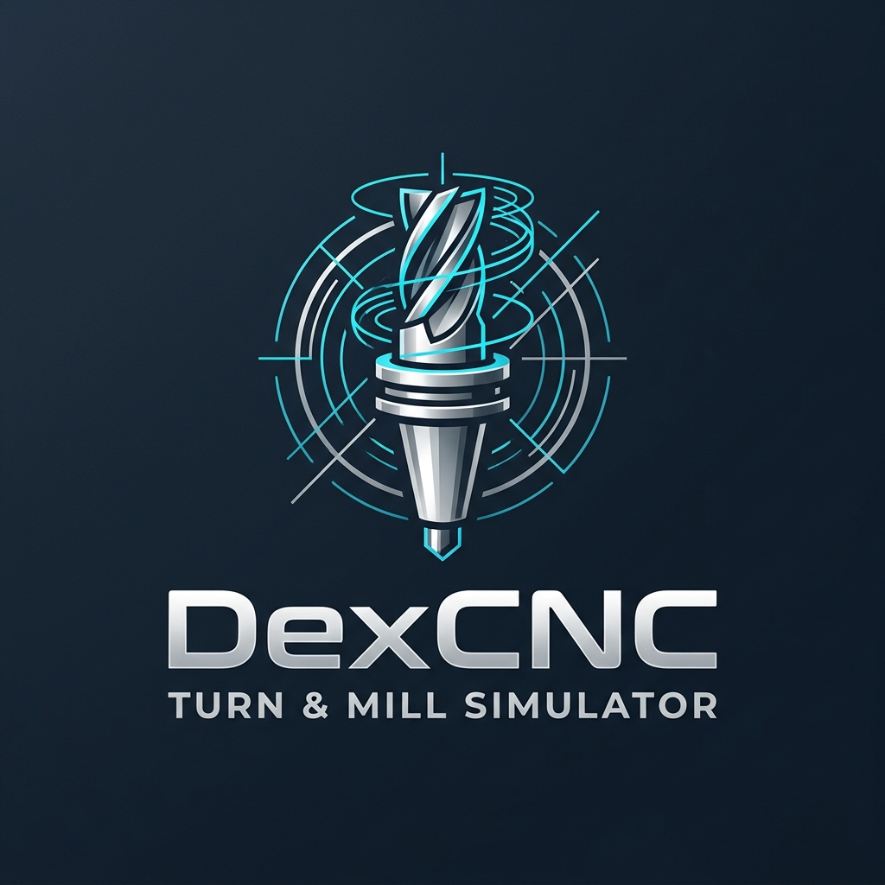

# DexCNC — CNC Turn & Mill 3D Simulator

  

**DexCNC** is a modern, high-precision 3D CNC simulator for **Turning (Lathe)** and **Milling** operations modeled after the **Fanuc Controller** standard. Built with WebGL/Three.js, Vite, and Electron, it offers realistic real-time material removal, toolpath verification, and interactive engineering blueprints.

---

## Key Features

- **Fanuc G-Code Parsing & Execution**:
  - Full support for standard Fanuc G-codes (G00, G01, G02, G03, G54 coordinate systems, canned cycles, canned threading, and grooving).
  - Real-time syntax validation, block-by-block stepping, and dynamic feed rate override.

- **High-Fidelity 3D Simulation Engine**:
  - **Turning Mode**: Realistic rotational material removal, sharp perpendicular step shoulders, dual CAD edge accent rings, customizable cylindrical bar or rectangular blanks.
  - **Milling Mode**: Multi-axis milling toolpaths, pocketing, facing, contouring, and 2.5D/3D surface cutting.
  - Interactive Camera: Orbit, pan, zoom, and predefined engineering views (Top XY, Front XZ, Isometric, Side).

- **Isolated Dual Workspaces**:
  - Independent Turning and Milling work environments with zero cross-mode buffer leakage.
  - Mode-specific default camera orientations and stock dimensions (default 100 mm × 100 mm).

- **Interactive Sample Gallery**:
  - Built-in library of turning and milling sample programs paired with dimensioned engineering blueprint sketches.

- **Safety & Productivity**:
  - Unsaved work guard alerts.
  - Local auto-save and state persistence.
  - Desktop-ready packaging via Electron (portable executable and Windows NSIS installer).

---

## Tech Stack

- **Core**: JavaScript (ES Modules), HTML5, Vanilla CSS
- **3D Graphics Engine**: Three.js / WebGL
- **Build Tool**: Vite
- **Desktop Shell**: Electron + electron-builder
